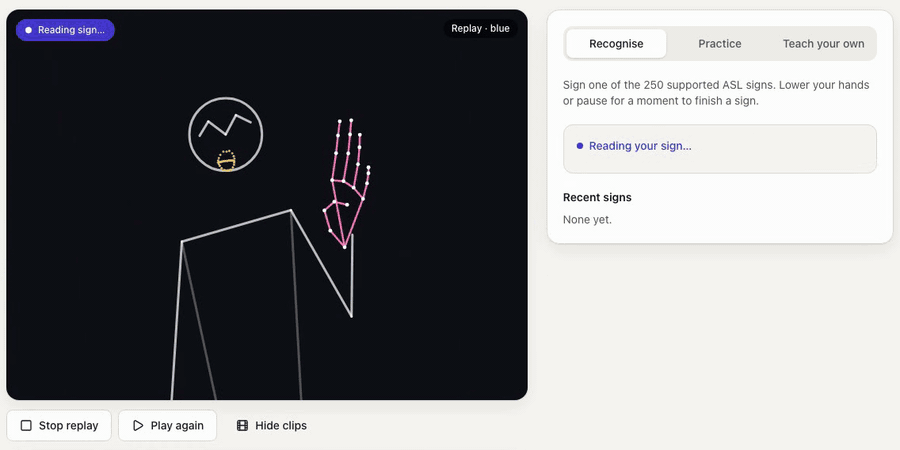
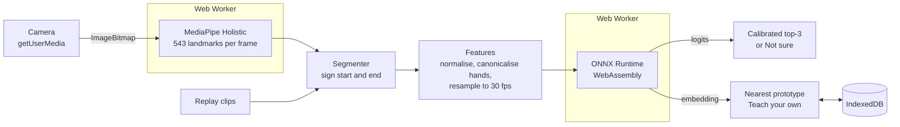
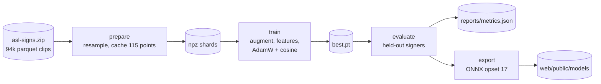

# GestureSign

Live American Sign Language recognition in the browser. You sign to your
webcam and the page shows its top three guesses for 250 isolated ASL signs.
There is also a practice mode that scores an attempt at a given sign, and a
"teach your own" mode that learns a new gesture from a few takes. Hand
tracking and the model both run on your device, and no video leaves the page.

**Try it:** https://shashank11yadav.github.io/GestureSign/



*Replay mode: real clips from signers the model never trained on, played as
landmarks (no video) through the same recogniser as the camera.*

On the three held-out signers the model gets 72.1% top-1 and 88.1% top-5
over all 250 signs (14,396 clips). Teach your own picks the right gesture
88.7% of the time with 8 gestures of 3 takes each. The details are in
[Results](#results).

## How it works

The model reads body landmarks, not pixels. MediaPipe turns each camera frame
into coordinates for the hands, upper body and lips, and a 1.4 M-parameter
convolution + transformer classifies the sequence. I went with landmarks
because they make the model much less sensitive to lighting, background,
skin tone and camera quality, and because a model over landmarks is small
enough to run in a browser tab.



### Training pipeline



## What it does

| Mode | What happens |
|---|---|
| Recognise | Sign continuously. A sign ends when your hands leave the frame or hold still for 300 ms; the page then shows the top three guesses with their confidence and adds the sign to a strip of recent ones. |
| Practice | The page picks a sign (with a link to its entry in an ASL dictionary) and scores your attempt by how strongly the model saw that sign. |
| Teach your own | Record 3 to 5 takes each of up to 8 gestures. New attempts are matched to the nearest prototype in the model's embedding space, so this works for any gesture, ASL or not. The takes are stored in your browser only. |
| Replay | For when you have no camera or would rather not use one: six held-out clips from the dataset go through the same recogniser. Only landmarks are bundled, so nobody's face or video is shown. |

Below a confidence threshold calibrated on signers the model never saw, the
page answers "Not sure" instead of naming a sign. It also won't guess when
nobody is in view or when only part of the signer is visible.

## Design decisions

- **I picked the landmark set by measuring it first.** Before training
  anything I set a bar: MediaPipe Holistic (hands, pose and face mesh) had to
  sustain 15 fps in Chrome on my M4 with DevTools CPU throttling at 4x, as a
  stand-in for a mid-range laptop. If it missed, the demo would use the Hand
  and Pose landmarkers and drop the lip features. Holistic ran at a median of
  16.8 fps, so the model sees hands, upper-body pose and 40 lip points.
  [`pipeline/reports/bench.md`](pipeline/reports/bench.md) has the numbers,
  and `npm run bench` reproduces them.
- **WebAssembly only.** The model has 1.4 M parameters and runs in a few
  milliseconds on a CPU, so ONNX Runtime's WebGPU build wouldn't make it
  noticeably faster. It would add a 27 MB runtime, though, and its loader
  needs a looser Content-Security-Policy. The site ships only the plain WASM
  runtime, and CI fails if any other build ends up in `dist/`.
- **Start loading before the click.** On page load the sign model and
  MediaPipe start loading in two workers in parallel, and each worker fetches
  its model file and its WASM runtime in parallel too. The camera still waits
  for a click. A first visit downloads about 48 MB, mostly the two WASM
  runtimes and the Holistic model.
- **Train/serve parity.** The features exist twice,
  in Python (`pipeline/src/gesturesign/features.py`) and TypeScript
  (`web/src/ml/features.ts`). Both test suites check the same fixture,
  [`shared/fixtures/features.json`](shared/fixtures/features.json), to within
  1e-4, including mirrored clips, a different camera aspect ratio, other frame
  rates and clips longer than the model's window.
- **Handedness and mirroring.** The signing hand always goes in the same
  slot, and the clip is mirrored if needed, so left-handed signers and
  mirrored or unmirrored cameras look the same to the model.
- **The portrait-vs-landscape stretch.** This one cost me a feature version.
  MediaPipe normalises x by the image width and y by its height. The training
  videos are portrait phone selfies and webcams are landscape, so a webcam
  stretched every vertical distance by about 1.8x compared with training. I
  now scale y by the face's vertical proportion (eye-to-mouth over
  ear-to-ear, from pose points), which cancels the camera's aspect ratio.
- **Signer-independent evaluation.** Three participants are held out for
  testing and two for validation. None of their clips is used for training or
  for choosing the checkpoint, the shipped sign set or the thresholds.
- **What ships.** I decided up front that if the full 250-sign set scored
  under 60% top-1 on held-out signers, the demo would ship the largest subset
  that reached 60%, chosen on the validation signers and reported on the test
  signers. The full set reached 74.4% on the validation signers, so all 250
  signs ship.

## Results

<!-- metrics -->
Held-out signers: 16069, 37055, 61333 (14396 clips, never seen in training or model selection).

| Sign set | Signs | Top-1 | Top-5 / Top-3 |
|---|---:|---:|---:|
| All signs | 250 | 72.1% | 88.1% (top-5) |
| Shipped in the demo | 250 | 72.1% | 85.3% (top-3) |

The shipped set is the largest set found whose top-1 on the validation signers is at least 60%; the test signers above did not take part in choosing it.

"Not sure" below 0.29 calibrated confidence: the demo answers 92% of test clips, and those answers are 77.1% correct.

Teach your own (8-way, 3-shot, cosine nearest prototype on test-signer embeddings): 88.7%.

| Most confused (true -> predicted) | Count | Share of true sign |
|---|---:|---:|
| awake -> wake | 38 | 61% |
| lamp -> snack | 28 | 48% |
| finger -> wait | 23 | 43% |
| quiet -> shhh | 21 | 37% |
| sleep -> nap | 21 | 36% |
| pencil -> pen | 19 | 29% |
| cry -> cheek | 18 | 30% |
| mouth -> lips | 18 | 30% |
| brother -> boy | 17 | 30% |
| pen -> pencil | 17 | 27% |
<!-- /metrics -->

Every number in this section comes from `uv run gesturesign evaluate`, which
writes [`pipeline/reports/metrics.json`](pipeline/reports/metrics.json) and
the tables above (`pipeline/reports/metrics.md`).

In short:

- Held-out top-1 is 72.1% and top-5 is 88.1% over all 250 signs. The demo
  shows three guesses, and the right sign is among them 85.3% of the time.
- The page says "Not sure" below a calibrated confidence of 0.29. It still
  answers 92% of held-out clips, and 77.1% of those answers are right.
- Teach your own picks the right gesture 88.7% of the time with 8 gestures of
  3 takes each (1,000 random episodes on held-out signers).

Most of the confusions are near-synonyms, which I find reassuring: the model
mixes up signs that look almost the same or mean almost the same thing, like
*awake* and *wake*, *quiet* and *shhh*, *sleep* and *nap*, *pen* and *pencil*
(both ways) and *mouth* and *lips*. Most of the rest are made at the same
place with a similar hand: *cry* and *cheek* (index fingers at the cheeks),
*brother* and *boy* (*brother* begins with the sign for *boy*), *finger* and
*wait*, and *lamp* and *snack*. Because the page shows three guesses, the
intended sign is usually still on screen when the first guess is its
look-alike.

<details>
<summary>The 250 signs that ship</summary>

TV, after, airplane, all, alligator, animal, another, any, apple, arm, aunt, awake, backyard, bad, balloon, bath, because, bed, bedroom, bee, before, beside, better, bird, black, blow, blue, boat, book, boy, brother, brown, bug, bye, call (on phone), can, car, carrot, cat, cereal, chair, cheek, child, chin, chocolate, clean, close, closet, cloud, clown, cow, cowboy, cry, cut, cute, dad, dance, dirty, dog, doll, donkey, down, drawer, drink, drop, dry, dryer, duck, ear, elephant, empty, every, eye, face, fall, farm, fast, feet, find, fine, finger, finish, fireman, first, fish, flag, flower, food, for, french fries, frog, garbage, gift, giraffe, girl, give, glass / window, go, goose, grandma, grandpa, grass, green, gum, hair, happy, hat, hate, have, have to, head, hear, helicopter, hello, hen, he / she / it, hide, high, home, horse, hot, hungry, ice cream, if, into, jacket, jeans, jump, kiss, kitty, lamp, later, like, lion, lips, listen, look, loud, mad, make, man, many, milk, mine / my, mitten, mom, moon, morning, mouse, mouth, nap, napkin, night, no, noisy, nose, not, now, nuts, old, on, open, orange, outside, owie, owl, pajamas, pen, pencil, penny, person, pig, pizza, please, police, pool, potty, pretend, pretty, puppy, puzzle, quiet, radio, rain, read, red, refrigerator, ride, room, sad, same, say, scissors, see, shh, shirt, shoe, shower, sick, sleep, sleepy, smile, snack, snow, stairs, stay, sticky, store, story, stuck, sun, table, talk, taste, thank you, that, there, think, thirsty, tiger, time, tomorrow, tongue, tooth, toothbrush, touch, toy, tree, uncle, underwear, up, vacuum, wait, wake, water, wet, we / us, where, white, who, why, will, wolf, yellow, yes, yesterday, yourself, yucky, zebra, zipper

The full asl-signs vocabulary; per-sign held-out accuracy is in
[`pipeline/reports/metrics.json`](pipeline/reports/metrics.json) (`perSign`)
and in [`web/public/models/labels.json`](web/public/models/labels.json).
</details>

## Model card

- **Task:** isolated sign classification (one sign per segment) over the 250
  signs of the asl-signs vocabulary, plus a 128-d embedding used for
  few-shot gestures (Teach your own).
- **Input:** up to 64 frames at 30 fps of 460 landmark features (hands, upper
  body, 40 lip points, presence flags and velocities).
- **Architecture:** three blocks of depthwise temporal convolution +
  transformer, masked mean pooling, a 128-d L2-normalised embedding and
  cosine-similarity logits. 1,395,520 parameters; ONNX (opset 17), 5.6 MB.
- **Data:** Google – Isolated Sign Language Recognition (Kaggle competition
  [`asl-signs`](https://www.kaggle.com/competitions/asl-signs/data), from the
  PopSign project), CC BY 4.0: about 94,000 clips of 250 signs from 21
  signers, recorded on phones and supplied as MediaPipe Holistic landmarks.
  Split by signer: 70,272 clips for training, 9,809 for validation (2
  signers) and 14,396 for testing (3 signers).
- **Training:** AdamW with warm-up and cosine decay, label smoothing and
  landmark augmentation (rotation, scale, shear, time stretch, dropped frames
  and hands), early stopping on validation top-1. The run stopped after 47
  epochs; the checkpoint from epoch 39 ships. Fixed seed (42).
- **Intended use:** learning and practising ASL vocabulary, and showing how
  on-device sign recognition works. It is not an interpreter, and it should
  not be used where a misrecognised sign could matter, such as
  accessibility-critical communication.
- **Limitations:**
  - Isolated signs only: no fingerspelling, grammar or sentences.
  - One person at a time. Holistic tracks one body, so with several people in
    view it may follow someone who is not signing.
  - 21 training signers, so signing styles, body types and framings unlike
    theirs are less well covered.
  - Lighting still matters indirectly: in dim or back-lit scenes MediaPipe
    loses the hands, and the model only sees what MediaPipe finds.
  - The aspect-ratio correction uses the face's proportions, which works for
    a typical framing but not for every camera position.
  - Near-synonym and look-alike signs get confused (see above), and facial
    grammar beyond the lips is not modelled.
- **Privacy:** everything runs on the visitor's device. The camera starts only
  after a click and stops when the tab is hidden or closed; frames are
  processed in the page and never uploaded. There is no server, account,
  cookie or analytics. Taught gestures are stored as embedding vectors
  (numbers, not images) in the browser's IndexedDB, and the page's Clear
  button removes them. The Content-Security-Policy allows only this site's own
  scripts, workers and files, plus `'wasm-unsafe-eval'`, which WebAssembly
  needs.

## Run it locally

### Web app only

Requires Node 24 (what CI uses). The trained model is committed, so you don't
need Python.

```sh
cd web
npm ci
npm run dev        # http://localhost:5330/GestureSign/
```

`npm run build` downloads the MediaPipe model at a pinned version, checks its
size and SHA-256 before writing it, and copies the WASM runtimes from
`node_modules`, so the site serves every file itself. Other scripts:

| Script | What it does |
|---|---|
| `npm test` | Unit tests (Vitest), including the feature-parity fixture |
| `npm run test:e2e` | Playwright end-to-end tests with landmark injection, no camera needed |
| `npm run lint`, `npm run typecheck`, `npm run format:check` | Static checks |
| `npm run bench` | The landmark benchmark behind the feature-set decision |
| `npm run cold-start` | First-visit start-up time in a fresh browser with a fake camera; add `-- --network broadband` for 50 Mbit/s |

### Full retrain

Requires Python 3.12 and [uv](https://docs.astral.sh/uv/). Download the
[Kaggle asl-signs](https://www.kaggle.com/competitions/asl-signs/data) data
(you have to accept the competition rules first) to
`../_datasets/asl-signs/asl-signs.zip`, next to this repository. The pipeline
reads the zip directly, so you don't need the 56 GB it takes extracted.
`--data-dir` or `$DATA_DIR` can point elsewhere.

```sh
cd pipeline
uv sync
uv run gesturesign prepare      # parquet -> landmark cache, about 3 min
uv run gesturesign train        # about 80 min on an Apple M4 (MPS), 47 epochs
uv run gesturesign evaluate     # held-out metrics, shipped set, thresholds
uv run gesturesign export       # web/public/models/{model.onnx, model-meta.json, labels.json}
uv run gesturesign replay-clips # the held-out clips for Replay mode
```

The times are from the run that produced the committed model, on my Apple M4
(10-core CPU and GPU, 16 GB). `prepare` is resumable, and `train` stops early
once validation top-1 hasn't improved for 8 epochs. The configuration and the
fixed seed are in [`pipeline/configs/default.toml`](pipeline/configs/default.toml).

`uv run gesturesign smoke` runs the whole chain on synthetic data in seconds,
and `uv run gesturesign export --stub` writes an untrained model with the same
inputs and outputs (the page then shows an "untrained preview model" notice).

## Repository layout

```
pipeline/   Python 3.12 package `gesturesign`: data, features, model, training,
            evaluation, ONNX export (uv, ruff, mypy, pytest)
web/        Vite + React + TypeScript + Tailwind demo (Vitest, Playwright, axe)
shared/     the feature-parity fixture both test suites check
docs/       the demo GIF
```

## Credits

- Data: Google – Isolated Sign Language Recognition (Kaggle, asl-signs),
  CC BY 4.0. Replay mode bundles the landmarks of six held-out clips from it.
- [MediaPipe](https://github.com/google/mediapipe) (Apache 2.0) for the
  Holistic landmarker.
- [ONNX Runtime Web](https://github.com/microsoft/onnxruntime) (MIT) for
  in-browser inference.
- Sign lookups link to [Signing Savvy](https://www.signingsavvy.com/).

## Licence

MIT, see [LICENSE](LICENSE). The dataset keeps its own licence (CC BY 4.0).
