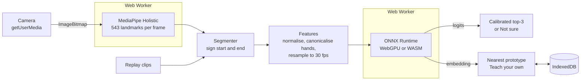
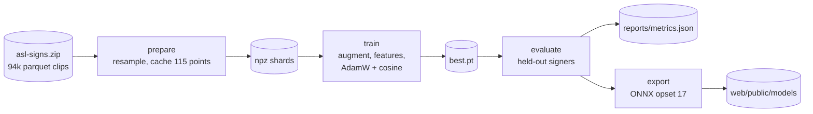

# GestureSign

Live American Sign Language recognition in the browser. Sign to your webcam
and see the top three guesses for 250 isolated ASL signs, practise a sign and
get a score, or teach the demo your own gestures in a few takes. Hand tracking
and the model both run on your device; no video leaves the page.

**Try it:** https://shashank11yadav.github.io/GestureSign/

<!-- gif -->

## What it does

| Mode | What happens |
|---|---|
| **Recognise** | Sign continuously. Each sign is cut out of the stream when your hands leave the frame or hold still for 300 ms, and the top three guesses are shown with their confidence, plus a strip of recent signs. |
| **Practice** | The page picks a sign (with a link to an ASL dictionary entry) and scores your attempt by how strongly the model saw that sign. |
| **Teach your own** | Record 3 to 5 takes of up to 8 gestures. They are recognised by nearest prototype on the model's embeddings, so this works for anyone, whether or not they sign ASL. Stored in this browser only. |
| **Replay** | No camera, or rather not use one? Replay recorded landmark clips through the same recogniser. |

Below a confidence threshold calibrated on signers the model never saw, the
page says **"Not sure"** instead of naming a sign. It also refuses to guess
when nobody is in view or when only part of the signer is visible.

## How it works

The model reads body landmarks, not pixels. MediaPipe turns each camera frame
into coordinates for the hands, upper body and lips; a 1.4 M-parameter
convolution + transformer classifies the sequence. Landmarks make the model
largely indifferent to lighting, background, skin tone and camera quality, and
small enough to run in a browser tab.



### Training pipeline



Design points:

- **Feature set chosen by measurement.** Holistic (hands, pose and face mesh)
  had to sustain 15 fps with 4x CPU throttling on an M4 to be used, otherwise
  the demo would fall back to hands and pose only. It ran at a median of
  16.8 fps, so the model also sees 40 lip points.
  [`pipeline/reports/bench.md`](pipeline/reports/bench.md) has the numbers and
  `npm run bench` reproduces them.
- **Train/serve parity.** Features are implemented twice, in Python
  (`pipeline/src/gesturesign/features.py`) and TypeScript
  (`web/src/ml/features.ts`). Both test suites check the same fixture,
  [`shared/fixtures/features.json`](shared/fixtures/features.json), to within
  1e-4, including mirrored clips, a different camera aspect ratio, other frame
  rates and clips longer than the model's window.
- **Handedness and mirroring.** The signing hand is always placed in the same
  slot, mirroring the clip if needed. Left-handed signers and mirrored or
  unmirrored cameras therefore look the same to the model.
- **Camera aspect ratio.** MediaPipe normalises x by width and y by height, so a
  landscape webcam stretches vertical distances relative to the portrait phone
  videos of the training data by about 1.8x. Features divide y by the face's
  vertical proportion, which cancels the camera's aspect ratio.
- **Signer-independent evaluation.** Three participants are held out for
  testing and two for validation; no clip of theirs is used in training.
- **What ships.** If the full 250-sign set misses 60% top-1 on held-out
  signers, the demo ships the largest subset that reaches it, chosen on the
  validation signers and reported on the test signers.

## Results

<!-- metrics -->

Every number here is produced by `uv run gesturesign evaluate`, which writes
[`pipeline/reports/metrics.json`](pipeline/reports/metrics.json) and the table
above (`pipeline/reports/metrics.md`).

## Run it locally

### Web app only

Requires Node 24.

```sh
cd web
npm ci
npm run dev        # http://localhost:5330/GestureSign/
```

`npm run build` fetches the MediaPipe models at pinned versions, checks their
SHA-256 and copies the WASM runtimes from `node_modules`, so the site serves
every file itself. Other scripts: `npm test` (unit), `npm run test:e2e`
(Playwright, no camera needed), `npm run lint`, `npm run typecheck`,
`npm run bench` (the landmark benchmark).

### Full retrain

Requires Python 3.12 and [uv](https://docs.astral.sh/uv/). Download the
[Kaggle asl-signs](https://www.kaggle.com/competitions/asl-signs/data) data
(accept the competition rules first) to `../_datasets/asl-signs/asl-signs.zip`
next to this repository. The pipeline reads the zip directly, so there is no
need to extract its 56 GB. `--data-dir` or `$DATA_DIR` can point elsewhere.

```sh
cd pipeline
uv sync
uv run gesturesign prepare      # parquet -> landmark cache (resumable), ~5-10 min
uv run gesturesign train        # ~1.5 min per epoch on an Apple M4 (MPS)
uv run gesturesign evaluate     # held-out metrics, ship set, thresholds
uv run gesturesign export       # web/public/models/{model.onnx, model-meta.json, labels.json}
uv run gesturesign replay-clips # a few held-out clips for Replay mode
```

`uv run gesturesign smoke` runs the whole chain on synthetic data in seconds.
`uv run gesturesign export --stub` writes an untrained model with the same
inputs and outputs, which is what the demo shows until a trained model is
committed. Configuration and the fixed seed live in
[`pipeline/configs/default.toml`](pipeline/configs/default.toml).

## Model card

- **Task:** isolated sign classification (one sign per segment) over the 250
  signs of the asl-signs vocabulary, plus an embedding for few-shot gestures.
- **Input:** up to 64 frames at 30 fps of 460 landmark features (hands, upper
  body, 40 lip points, presence flags and velocities).
- **Architecture:** three blocks of depthwise temporal convolution + transformer,
  masked mean pooling, a 128-d L2-normalised embedding and cosine-similarity
  logits. About 1.4 M parameters; ONNX, about 5 MB.
- **Data:** Google's Isolated Sign Language Recognition data (Kaggle
  `asl-signs`, from the PopSign project): about 94,000 clips from 21 signers,
  recorded on phones and converted to MediaPipe Holistic landmarks.
- **Intended use:** a learning aid and a demonstration of on-device sign
  recognition. It is **not** a sign-language translator, and it should not be
  used where a misrecognised sign could matter.
- **Limitations:** isolated signs only, no grammar or sentences; 21 training
  signers, so unusual signing styles, body types and framings are less well
  covered; the training videos are phone selfies, so a very different camera
  position can reduce accuracy; similar handshapes and motions are confused
  (see the confusion table above).
- **Failure cases:** shoulders out of view (the page asks you to move back);
  very fast or very slow signing; signs that rely on facial grammar beyond the
  lips; several people in frame (Holistic tracks one person, who may not be the
  signer).

## Privacy

- The camera starts only after a click and stops when the tab is hidden or
  closed.
- Frames are processed in the page. There is no server, account, cookie or
  analytics, and nothing is uploaded.
- Taught gestures are stored as embedding vectors (numbers, not images) in
  IndexedDB in your browser, and the page's Clear button removes them.
- A strict Content-Security-Policy allows only this site's own scripts, workers
  and files (plus `'wasm-unsafe-eval'`, which WebAssembly needs).

## Repository layout

```
pipeline/   Python 3.12 package `gesturesign`: data, features, model, training,
            evaluation, ONNX export (uv, ruff, mypy, pytest)
web/        Vite + React + TypeScript + Tailwind demo (Vitest, Playwright, axe)
shared/     the feature-parity fixture both test suites check
```

## Credits

- Data: Google – Isolated Sign Language Recognition (Kaggle, asl-signs),
  CC BY 4.0. Replay mode bundles a few held-out clips from it once
  `gesturesign replay-clips` has been run; until then it plays synthetic
  motion patterns.
- [MediaPipe](https://github.com/google/mediapipe) (Apache 2.0) for the
  hand, pose and face landmarkers.
- [ONNX Runtime Web](https://github.com/microsoft/onnxruntime) (MIT) for
  in-browser inference.
- Sign lookups link to [Signing Savvy](https://www.signingsavvy.com/).

## Licence

MIT, see [LICENSE](LICENSE). The dataset keeps its own licence (CC BY 4.0).
